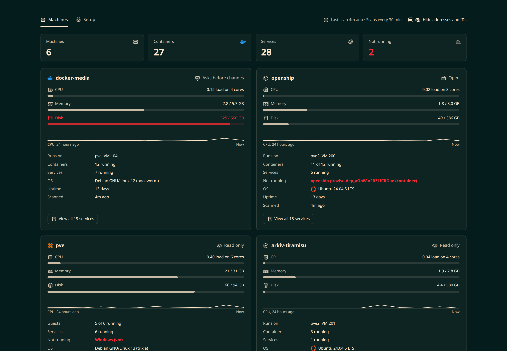
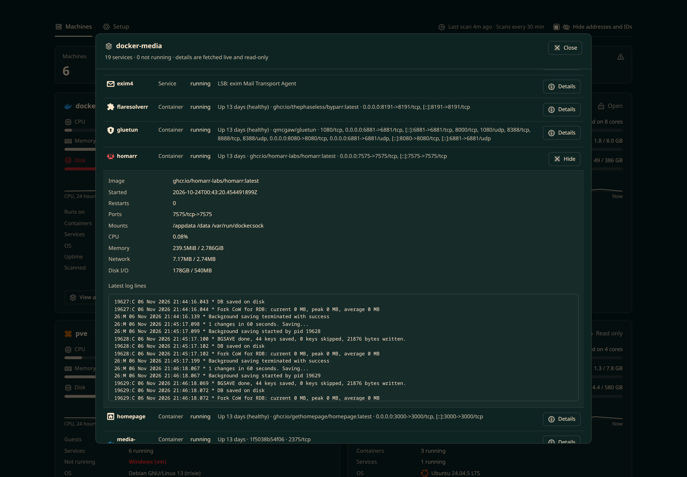
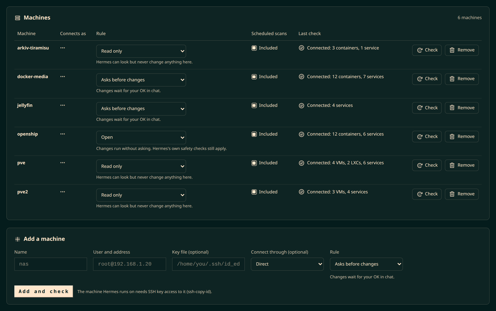
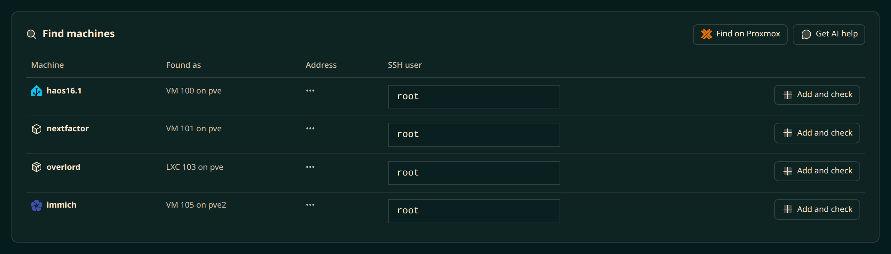
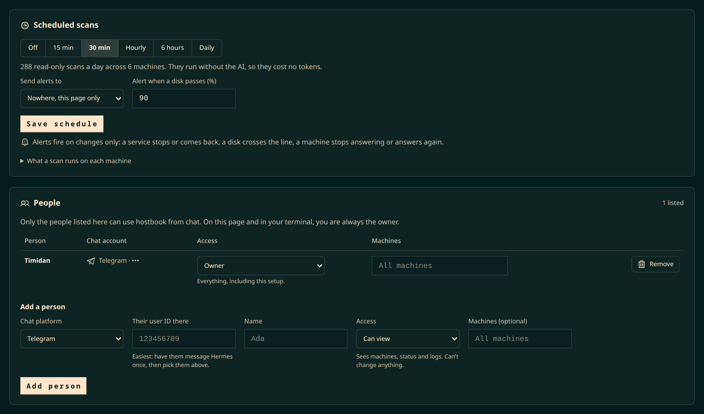
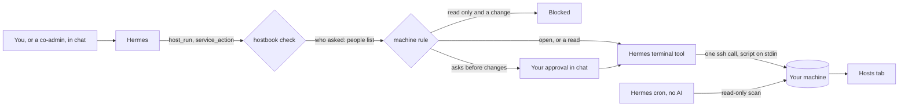

# hostbook

**Run scripts on your named machines in one call, with no quoting, under per-machine rules, and see your whole homelab in the Hermes dashboard.**

A plugin for [Hermes Agent](https://github.com/NousResearch/hermes-agent). Requires Hermes 0.22.0 or newer. MIT licensed.



## Why

Hermes reaches your servers by typing `ssh` into its terminal. That breaks more often than it looks. In one homelab's six months of Hermes history, 188 commands failed on shell quoting alone, Python scripts died squeezed into nested quotes, and the same machine was reached as two or three different users.

hostbook gives Hermes a list of your machines and a tool that sends a whole script to one or more of them, exactly as typed. Rules you set per machine decide what may change it, and people you invite get only the access you give them.

## Features

- **`host_run`**: run a bash, sh or Python script on one or more machines by name. No escaping, no wrapper commands.
- **Per-machine rules**: *read only*, *asks before changes* or *open*, checked before every call and layered on Hermes's own approval checks.
- **Services**: what runs where (Docker containers, systemd services, Proxmox VMs and LXCs), with status, logs, restart, start, stop and update.
- **Co-admins**: invite people by their chat account (Telegram, Discord, Slack and the other platforms Hermes supports) as *can view*, *can operate* or *owner*, optionally limited to some machines.
- **Scheduled scans without the AI**: a Hermes cron job scans every machine on your schedule, costs no tokens, and messages you only when something changes.
- **Hosts tab in the Hermes dashboard**: usage and 24-hour history per machine, every service with live details, and a setup page.
- **Finding machines**: add one Proxmox node and hostbook offers its VMs and containers; or ask your model to read the network neighbour tables and suggest what's worth adding.

## Screenshots

| | |
|---|---|
|  |  |
| **Every service on a machine**, with live, read-only details for any of them. | **Setup**: each machine's rule, schedule and connection check. |
|  |  |
| **Find machines** on Proxmox or with your model's help. | **Scheduled scans and people.** |

Screenshots use the tab's *Hide addresses and IDs* switch.

## Quick start

1. Install and enable the plugin, then restart the dashboard so the **Hosts** tab appears:

   ```bash
   hermes plugins install hostbook        # from the Hermes plugin catalog, once listed
   # or: hermes plugins install https://github.com/Timidan/hostbook
   hermes plugins enable hostbook
   ```

2. Make sure the machine Hermes runs on can reach your machines with a key:

   ```bash
   ssh-copy-id root@192.168.1.20
   ```

3. Add your first machine, from whichever surface you use:

   - **Dashboard**: Hosts → Setup → *Add a machine*.
   - **Chat**: "add my server root@192.168.1.20 as nas".
   - **Command line**: `hermes hostbook add nas root@192.168.1.20 --rule read`

   Each add checks the connection straight away and, if it fails, says what to fix.

4. Optionally, turn on scheduled scans: Setup → *Scheduled scans*, or `hermes hostbook schedule 30m`.

The [guide](docs/guide.md) covers each step in detail, including discovery and troubleshooting.

## How it works



`host_run` builds one `ssh` call per machine and passes your script on standard input through a quoted heredoc, so nothing in it is interpreted twice. The call runs through Hermes's own terminal tool, which keeps Hermes's approval checks, timeouts and output limits. Before it runs, hostbook checks who asked and the machine's rule. Scans for the dashboard and the schedule run a fixed, read-only script you can read in Setup.

## Reference

### Tools Hermes gets

| Tool | What it does |
|---|---|
| `host_run` | Runs a script on one or more machines. |
| `host_services` | Lists what runs on each machine, with usage; scans if asked or never scanned. |
| `service_action` | Status, logs, restart, start, stop or update for one service. |
| `hostbook_setup` | Adds, removes or changes machines, finds new ones, sets the schedule. Owner only, and changes ask for approval. |

### Machine rules

| Rule | Reads | Changes |
|---|---|---|
| Read only | Allowed | Blocked |
| Asks before changes | Allowed | Wait for your approval in chat |
| Open | Allowed | Run, under Hermes's own safety checks |

### Access for people

| Access | Scans, status, logs | Custom scripts and changes | Setup |
|---|---|---|---|
| Can view | Yes | No | No |
| Can operate | Yes | Yes, within each machine's rule | No |
| Owner | Yes | Yes, within each machine's rule | Yes |

You at Hermes's own terminal or dashboard are always the owner. Details and limits: [access control](docs/access-control.md).

### Command line

| Command | |
|---|---|
| `hermes hostbook add <name> <user@address[:port]> [--key PATH] [--jump NAME] [--rule read\|approve\|open]` | Add or update a machine and check it. |
| `hermes hostbook remove <name>` | Remove a machine and its scan data. |
| `hermes hostbook list` | Machines, rules and the last scan. |
| `hermes hostbook scan` | Scan every machine now. |
| `hermes hostbook schedule off\|15m\|30m\|1h\|6h\|daily [--deliver TARGET]` | Set scheduled scans and where alerts go. |

### Where hostbook keeps its data

Everything lives in `plugin-data/hostbook/` in your Hermes home.

| File | Contents |
|---|---|
| `hosts.yaml` | Machines: address, user, port, key path, jump host, rule. |
| `people.yaml` | Co-admins by chat account. |
| `settings.yaml` | Scan frequency, alert target, disk threshold. |
| `services.json`, `history.json` | The last scan and 24 hours of usage. |
| `recent.json` | The last 20 chat accounts that messaged Hermes, for picking co-admins. |

## Troubleshooting

| You see | What to do |
|---|---|
| Key refused | `ssh-copy-id user@address` from the machine Hermes runs on, or set the machine's key file. |
| SSH isn't answering on port 22 | Start the SSH server there, or set the right port. |
| Not reachable | Check it's on and on the same network as Hermes. |
| Name not found | Use the IP address. |
| This machine's identity changed | If you rebuilt it, run `ssh-keygen -R <address>`. If not, find out why before connecting. |
| Containers hidden | The SSH user can't read Docker; add it to the `docker` group. |
| No Hosts tab | Enable the plugin, then restart the Hermes dashboard. |

More in the [guide](docs/guide.md#troubleshooting).

## Security and privacy

hostbook connects only to machines you add, stores key paths but never keys, runs read-only scripts outside chat turns, and calls your model only when you click *Get AI help*. It keeps no telemetry. Rules and co-admin access are guardrails, not a sandbox, and the [security notes](docs/security.md) say exactly where their limits are.

## Development

```bash
python3 test_hostbook.py                 # self-check, no Hermes needed
hermes plugins validate . --install-deps  # the same check the plugin catalog runs
```

| Path | |
|---|---|
| `__init__.py` | Tools, hooks, access control, storage, scheduling, CLI. |
| `services.py` | Scan, details and discovery scripts; parsing; failure messages. |
| `dashboard/` | The Hosts tab: manifest, read-mostly API routes, and the page. |

## Credits

- Interface icons: [Phosphor Icons](https://phosphoricons.com) (MIT).
- Service logos: [Simple Icons](https://simpleicons.org) (CC0). Logos and trademarks belong to their owners and identify the software running on your machines; see the Simple Icons [disclaimer](https://github.com/simple-icons/simple-icons/blob/develop/DISCLAIMER.md).
- Glyphs for services without a public logo (Bazarr, Prowlarr, Seerr, Gluetun, FlareSolverr, Homepage, Samba, NFS, fail2ban, mail, Windows) are original to hostbook.

## License

[MIT](LICENSE)
